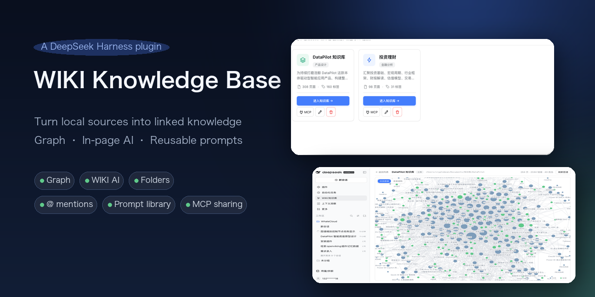
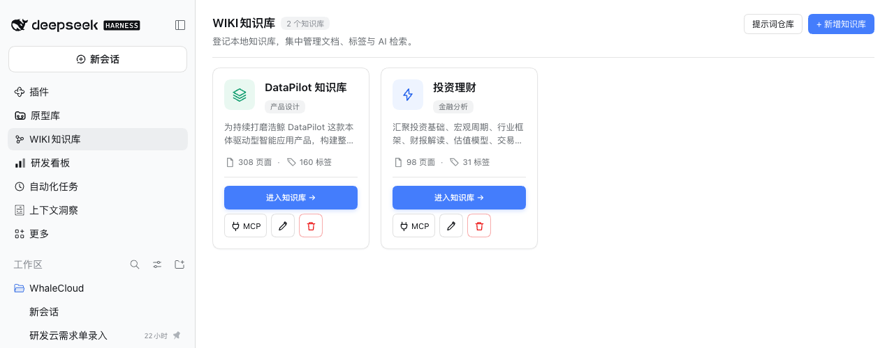
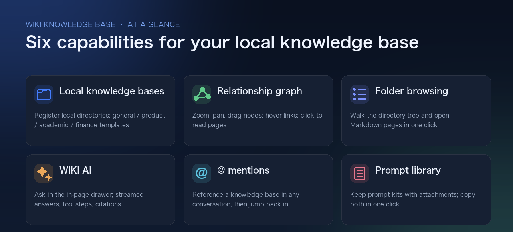
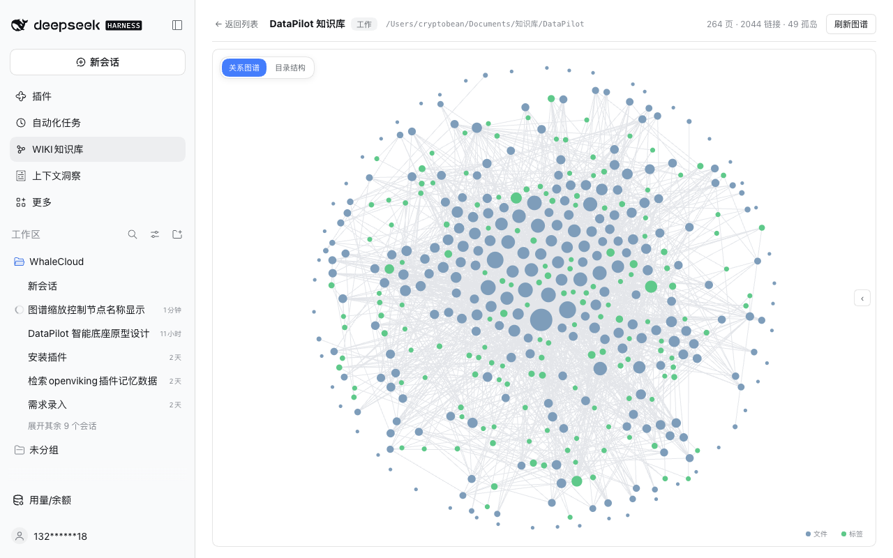
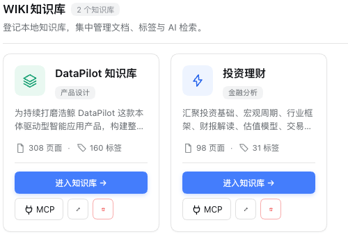
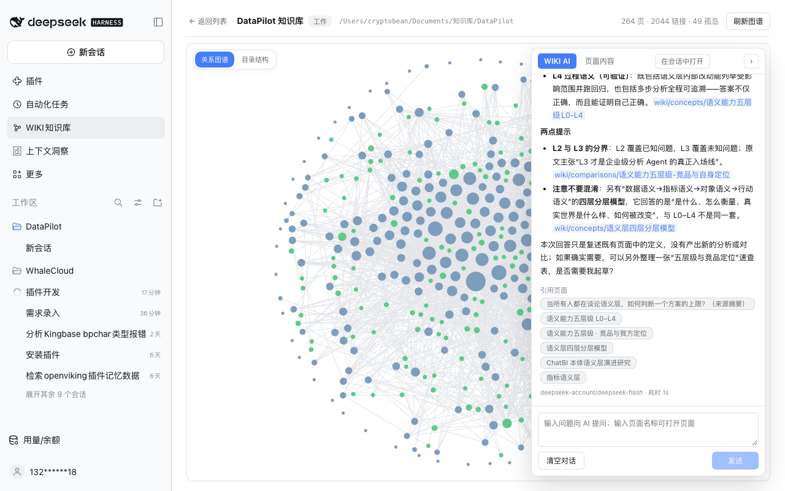
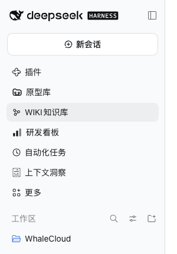
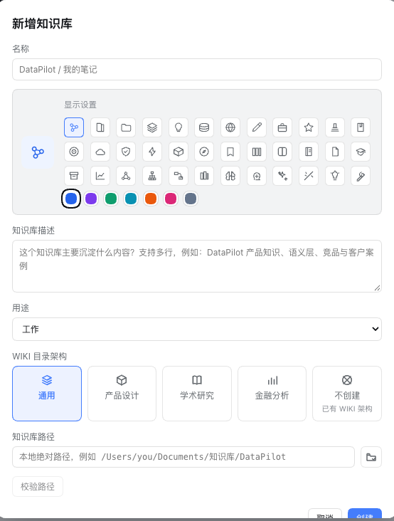
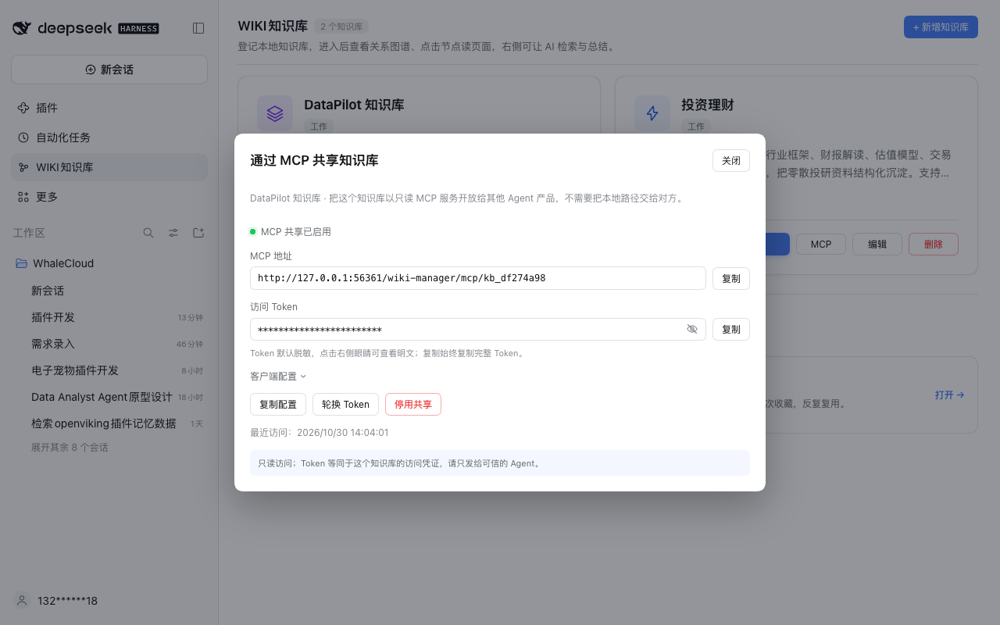

# WIKI Knowledge Base

**A local knowledge-base plugin for DeepSeek Harness. Turn accumulated sources into connected, traceable knowledge that can evolve over time.**

[简体中文](README.md) · **English**

> **Inspired by Andrej Karpathy’s “LLM Wiki.”** The former Tesla Director of AI and OpenAI founding member describes a way to use LLMs to organize personal sources into a structured, interconnected knowledge base, rather than simply building a conventional encyclopedia website. WIKI Knowledge Base brings this approach into DeepSeek Harness through knowledge-base management, graph browsing, and Agent collaboration.
>
> [Read the original LLM Wiki](https://gist.github.com/karpathy/442a6bf555914893e9891c11519de94f) · [About Karpathy](https://karpathy.ai/)





[Design philosophy](#design-philosophy) · [Core features](#core-features) · [Quick start](#quick-start) · [Workflows](#workflows) · [Configuration and development](#configuration-and-development)

## Design philosophy

**You select sources, ask questions, and judge their value. AI organizes, connects, updates, and maintains the knowledge.**

In Karpathy’s LLM Wiki approach, an LLM integrates incoming sources into an existing wiki: refining concepts, updating topics, linking evidence, and flagging conflicting claims. The results persist as Markdown files, giving future research a foundation to build on. [Source](https://gist.github.com/karpathy/442a6bf555914893e9891c11519de94f)

The plugin’s architecture prompts organize this workflow into three layers:

| Layer | Responsibility | Typical location |
| --- | --- | --- |
| Raw sources | Preserve articles, papers, meeting notes, and other evidence for traceability | `raw/` |
| Compiled knowledge | Let AI integrate sources into concepts, entities, topics, and syntheses | `wiki/` |
| Maintenance rules | Define directories, formats, citations, and update workflows so work can continue across sessions | `CLAUDE.md`, `AGENTS.md`, `templates/` |

**WIKI Knowledge Base provides the management and reading interface for this workflow.** Run the architecture prompt with an Agent to initialize the structure. The Agent organizes sources and updates knowledge according to the knowledge base’s rules; writes follow the host’s approval mechanism.

## Core features

| Feature | What you can do |
| --- | --- |
| **Local knowledge-base management** | Register an existing directory or choose a general, product-design, academic-research, or financial-analysis template; customize names, descriptions, icons, and colors |
| **Graph and directory browsing** | Explore pages, tags, and wiki links; switch to a folder tree and open Markdown pages directly |
| **WIKI AI** | Ask the native Agent in an in-page drawer, follow streamed answers, tool steps, and citations; stop a response or continue in a native session |
| **`@` knowledge-base references** | Reference a knowledge base in any conversation, passing its name and root directory to the Agent; click the reference to open it |
| **Prompt library** | Save reusable prompt kits with attachments; copy a prompt together with local attachment paths |
| **Read-only MCP sharing** | Generate a dedicated endpoint and token so other compatible Agents can search, read, and explore related pages |



### Explore connections

Knowledge bases open in graph view. Zoom, pan, drag nodes, hover to highlight connections, and click to read a page. Toggle file and tag nodes independently, or switch to directory view to locate files. Returning to the panel can restore your last reading position.





### Ask while you read

The **WIKI AI** drawer keeps reading and conversation together. Enter a title or path to find a page, or press Enter to ask the Agent. Citations let you return to the evidence. If the Agent is unavailable, the plugin falls back to its local keyword-retrieval pipeline.



## Quick start

### 1. Install the plugin

Prerequisites: an installed DeepSeek Harness instance, a working profile, and `pnpm`.

Run the following in your target profile directory. The desktop default is `~/.dsh/profiles/desktop`:

```bash
cd ~/.dsh/profiles/desktop
pnpm add "file:/absolute/path/to/dsh-llm-wiki"
```

Add the package name to `dsh.profile.bundles` in that profile’s `package.json`, keeping existing entries:

```json
{
  "dsh": {
    "profile": {
      "bundles": ["@local/dsh-llm-wiki"]
    }
  }
}
```

Restart DeepSeek Harness. The **WIKI知识库** entry will appear in the sidebar.



### 2. Create or connect a knowledge base

1. Click **“+ 新建知识库”** (New knowledge base). Enter a name, description, purpose, and absolute local path. The directory must already exist.
2. Choose a **WIKI directory architecture**: general, product design, academic research, financial analysis, or no initialization for an existing wiki.
3. For a new architecture, copy the prompt shown after creation and run it with an Agent to initialize directories and maintenance rules. Existing wikis can be opened directly.



### 3. Start building knowledge

Place sources in the knowledge base. In WIKI AI or a conversation referencing the knowledge base, ask the Agent to process sources, maintain connections, and answer questions according to its rules. Explore the graph and follow source citations to verify conclusions.

## Workflows

### Organize, query, and maintain

Start with requests such as:

- **Process sources:** “Process the new sources according to this wiki’s rules. Update related topics and concepts, preserving source citations.”
- **Synthesize research:** “Summarize the main conclusions, disagreements, and evidence gaps on this topic using the existing sources.”
- **Maintain the wiki:** “Check for broken links, orphan pages, and content that needs updating.”

Execution depends on the knowledge base’s rules, Agent tools, and host permissions. Structured maintenance tasks fall back to a local rules pipeline when no Agent is available.

### Reference a knowledge base in any conversation

Type `@` and select a knowledge base from the “知识库” group. The reference includes its name and root directory so the Agent can read the sources. **Use the `@` menu for knowledge-base references.** In newer DSH versions, the input’s `+` menu lists slash commands.

### Reuse prompts and attachments

Open **“提示词仓库”** (Prompt library) at the top right of the knowledge-base list. Create kits containing a name, description, prompt, and attachments. Each attachment may be up to **50 MB**. Copying a kit includes the attachments’ absolute local paths for the Agent to read; it does not paste binary files as native conversation attachments.

### Share with other Agents

1. Click **MCP** on a knowledge-base card and enable sharing.
2. Copy the endpoint, Bearer token, or full client configuration into a client that supports the corresponding HTTP MCP configuration.
3. Access the knowledge base with five read-only tools: `kb_info`, `kb_search`, `kb_read`, `kb_list`, and `kb_related`. MCP resource reading is also supported.

Rotate the token or disable sharing at any time. The default endpoint uses `127.0.0.1`; access from another machine requires a reachable `publicBaseUrl`. **The token grants knowledge-base access. Share it only with trusted clients.**



## Data and limitations

- **Local files:** the plugin registers directories and reads their Markdown files. Removing a knowledge base from the list does not delete its source files. Data sent for AI requests depends on the selected model provider.
- **Registry:** stored at `$DSH_HOME/wiki-manager/knowledge-bases.json` by default; override it with `dataFile`.
- **Graph scope:** scans Markdown throughout the knowledge base, including `wiki/` and `raw/`. The graph displays up to 900 page nodes and up to 160 tags occurring at least twice. PDFs and images are not graph nodes.
- **Retrieval:** the local fallback pipeline uses keyword retrieval. Native Agent capabilities depend on tools provided by the host.
- **Rendering and performance:** pages support Markdown, but not Obsidian plugin syntax such as Dataview or Bases. Large graphs may take several seconds to settle.

## Configuration and development

See the **[development and configuration reference (Chinese)](docs/DEVELOPMENT.md)** for configuration, HTTP APIs, MCP behavior, architecture prompt customization, and implementation details.

- Host: `index.js` provides registration, scanning, page reading, AI, and MCP services.
- Client: `client.js` provides the sidebar, main panel, and prompt library.
- Templates: `templates/wiki-arch-prompt*.md`. Reopen the architecture prompt dialog to load edits.
- Configuration: `cordis.patch.yml`. Restart after Host or configuration changes; refresh the page after Client changes.

To uninstall, run `pnpm remove @local/dsh-llm-wiki` in the profile directory and remove the package from `dsh.profile.bundles`. Registry data remains in `$DSH_HOME/wiki-manager/` by default.

## Acknowledgments

The design philosophy comes from **[Andrej Karpathy’s LLM Wiki](https://gist.github.com/karpathy/442a6bf555914893e9891c11519de94f)**. This plugin applies that method within DeepSeek Harness. Its graph interactions draw inspiration from Obsidian’s reading experience.
