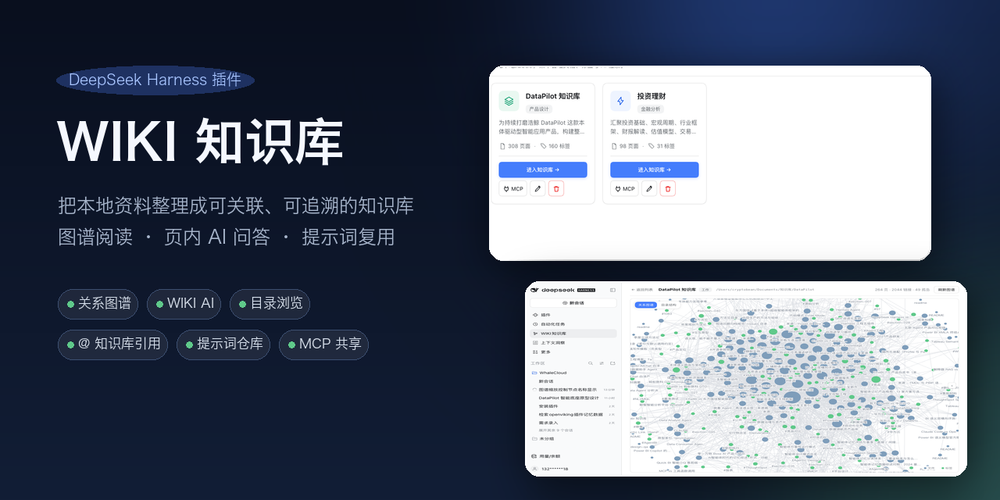
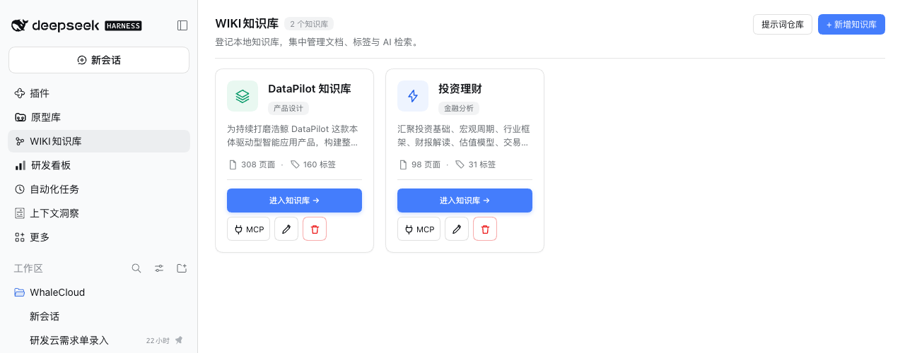
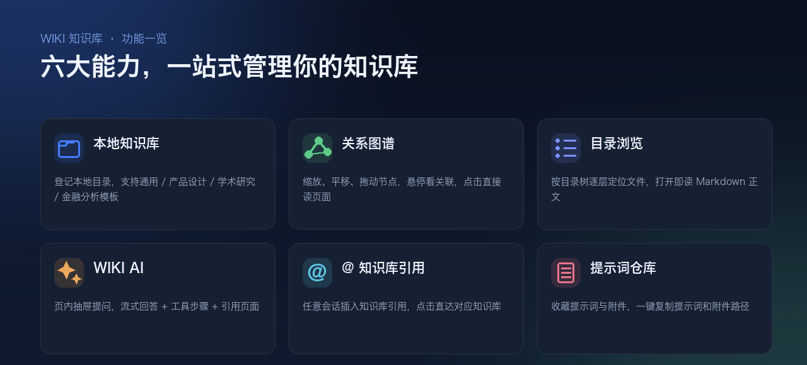
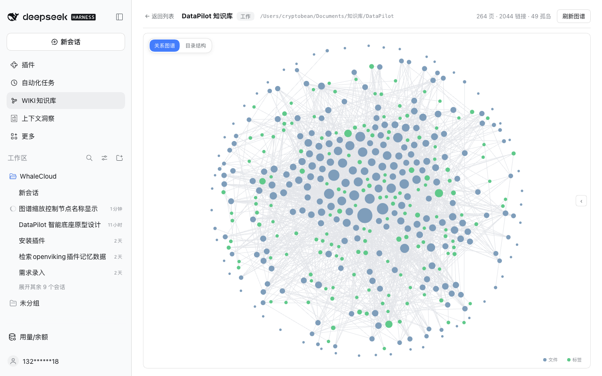
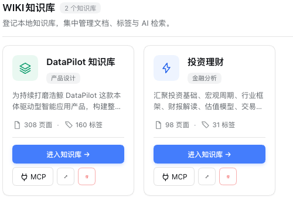
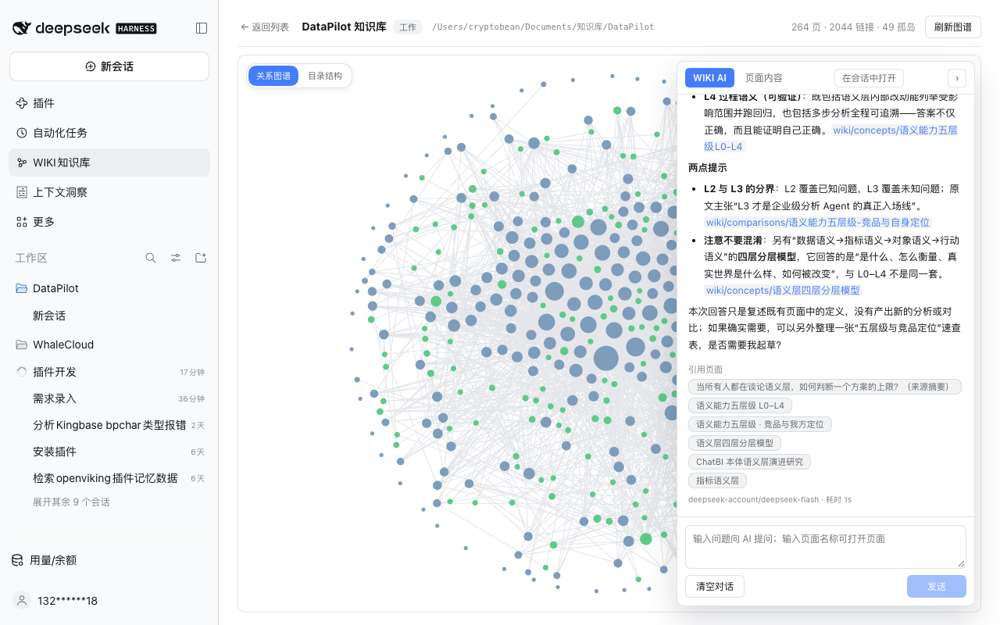
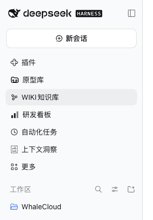
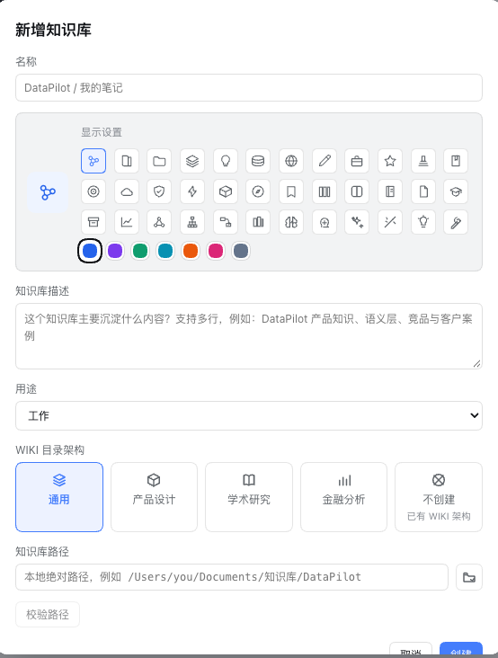
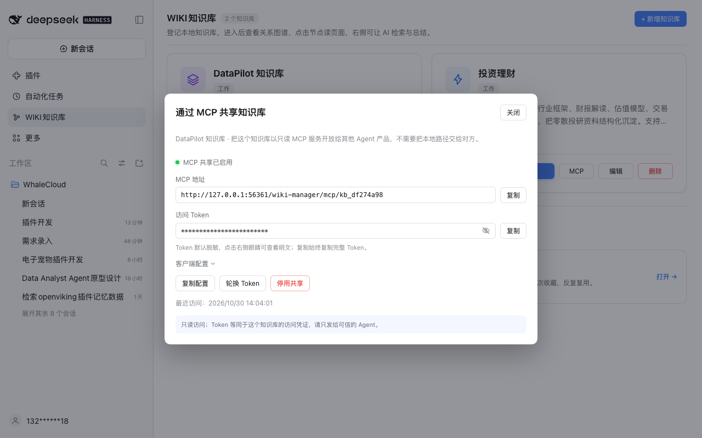

# WIKI 知识库

**DeepSeek Harness 的本地知识库插件，让资料逐步积累为可关联、可追溯、可持续维护的知识。**

**简体中文** · [English](README.en.md)

> **设计理念源自 Andrej Karpathy 的「LLM Wiki」。** 这位前特斯拉 AI 总监、OpenAI 创始成员提出：用大语言模型将个人资料持续整理为结构化、相互关联的知识库，而不只是搭建传统百科网站。WIKI 知识库将这一理念带入 DeepSeek Harness，提供知识库管理、图谱阅读和 Agent 协作入口。
>
> [阅读 LLM Wiki 原文](https://gist.github.com/karpathy/442a6bf555914893e9891c11519de94f) · [Karpathy 个人简介](https://karpathy.ai/)





[设计理念](#设计理念) · [核心能力](#核心能力) · [快速上手](#快速上手) · [使用方式](#使用方式) · [配置与开发](#配置与开发)

## 设计理念

**人负责选择资料、提出问题与判断价值，AI 负责整理、关联、更新和维护。**

在 Karpathy 的 LLM Wiki 方法中，AI 会把新资料整合到已有知识中：补充概念、更新主题、建立引用，并标记相互冲突的观点。整理结果保存在持久化的 Markdown 文件里，后续研究可以沿着已有知识继续积累。[方法来源](https://gist.github.com/karpathy/442a6bf555914893e9891c11519de94f)

插件内置的架构提示词将这一方法组织为三层：

| 层次 | 职责 | 典型位置 |
| --- | --- | --- |
| 原始资料 | 保存文章、论文、会议记录等来源，保留可追溯的证据 | `raw/` |
| 知识编译 | 由 AI 整合来源，维护概念、实体、主题与综合分析 | `wiki/` |
| 维护规则 | 约定目录、格式、引用及更新流程，让不同会话接续工作 | `CLAUDE.md`、`AGENTS.md`、`templates/` |

**WIKI 知识库是这套工作流的管理与阅读界面。** 架构提示词需要交给 Agent 执行；资料整理和知识更新由 Agent 按知识库规则完成，写操作遵循宿主审批机制。

## 核心能力

| 能力 | 你可以做什么 |
| --- | --- |
| **本地知识库管理** | 登记已有目录，或选择通用、产品设计、学术研究、金融分析模板；自定义名称、描述、图标与底色 |
| **关系图谱与目录浏览** | 通过页面、标签和双向链接探索知识；切换目录逐层浏览，点击 Markdown 页面直接阅读 |
| **WIKI AI** | 在页内抽屉向原生 Agent 提问，查看流式回答、工具步骤与引用；支持停止或转到原生会话继续 |
| **会话中的 `@知识库`** | 在任意会话插入知识库引用，把名称与根目录交给 Agent；点击引用可打开对应知识库 |
| **提示词仓库** | 收藏提示词与附件，按套件复用；一键复制提示词及附件本地路径 |
| **只读 MCP 共享** | 为知识库生成独立端点与 Token，让其他兼容 Agent 检索、阅读和探索关联页面 |



### 看见知识之间的联系

默认进入关系图谱：缩放、平移、拖动节点，悬停查看关联，点击阅读正文；右下角可分别显示或隐藏文件与标签。需要定位文件时，切换到目录结构。再次进入时可恢复上次阅读位置。





### 在阅读中提问

右侧 **WIKI AI** 抽屉将阅读与问答放在同一处。输入标题或路径可查找页面，按回车向 Agent 提问；回答中的引用帮助你回到资料核对依据。Agent 不可用时，系统会回退到本地关键词检索管线。



## 快速上手

### 1. 安装插件

前提：已安装 DeepSeek Harness，具备可用的 profile 环境及 `pnpm`。

在目标 profile 目录执行（桌面版默认目录为 `~/.dsh/profiles/desktop`）：

```bash
cd ~/.dsh/profiles/desktop
pnpm add "file:/absolute/path/to/dsh-llm-wiki"
```

将包名加入该 profile 的 `package.json` → `dsh.profile.bundles` 数组，保留已有条目：

```json
{
  "dsh": {
    "profile": {
      "bundles": ["@local/dsh-llm-wiki"]
    }
  }
}
```

重启 DeepSeek Harness，侧边栏会出现 **WIKI知识库**。



### 2. 创建或接入知识库

1. 点击 **「+ 新建知识库」**，填写名称、描述、用途与本地绝对路径；目录需已存在。
2. 选择 **WIKI 目录架构**：通用、产品设计、学术研究、金融分析，或「不创建（已有 WIKI 架构）」。
3. 新建架构时，复制创建成功后显示的提示词，交给 Agent 执行，初始化目录与维护规则；接入已有架构可直接进入。



### 3. 开始积累知识

把资料放入知识库，在 WIKI AI 或引用该库的会话中，请 Agent 按规则整理资料、维护关联并回答问题。通过图谱检查知识联系，通过来源引用核对结论。

## 使用方式

### 让 Agent 整理、查询和维护

可直接从这些请求开始：

- **整理资料**：「按本库规则处理新增资料，更新相关主题和概念，保留来源引用。」
- **综合研究**：「结合现有资料，总结这个主题的主要结论、分歧与证据缺口。」
- **维护知识库**：「检查知识库中的断链、孤立页面和需要更新的内容。」

具体执行取决于知识库规则、Agent 工具与宿主授权。结构化维护任务在无 Agent 时回退到本地规则管线。

### 在任意会话引用知识库

输入 `@`，在「知识库」分组中选择目标库。引用会携带知识库名称、根目录与内部 URL，Agent 可据此读取资料。**知识库引用使用 `@` 菜单**；新版 DSH 输入框左侧的 `+` 菜单用于斜杠指令。

### 复用提示词与附件

在知识库列表右上角打开 **「提示词仓库」**，创建包含名称、描述、提示词和附件的套件。单个附件最大 **50 MB**；一键复制包含附件的本地绝对路径，Agent 可据此读取文件。复制操作不会将二进制附件直接变成会话附件。

### 共享给其他 Agent

1. 点击知识库卡片上的 **MCP**，启用共享。
2. 复制端点、Bearer Token 或完整客户端配置，添加到支持相应 HTTP MCP 配置的客户端。
3. 通过 `kb_info`、`kb_search`、`kb_read`、`kb_list`、`kb_related` 五个只读工具访问知识库；也支持 MCP 资源读取。

可随时轮换 Token 或停用共享。默认端点使用 `127.0.0.1`；跨机器访问需配置可达的 `publicBaseUrl`。**Token 是知识库访问凭证，请仅交给可信客户端。**



## 数据与使用边界

- **文件保存在本地**：插件登记目录并读取其中的 Markdown；从列表移除知识库不会删除本地资料。AI 请求的数据传输取决于所选模型服务。
- **登记表**：默认位于 `$DSH_HOME/wiki-manager/knowledge-bases.json`，可通过 `dataFile` 配置覆盖。
- **图谱范围**：扫描全库 Markdown，包括 `wiki/`、`raw/` 等目录；页面节点最多 900 个，标签仅显示出现至少两次的标签，最多 160 个。PDF 和图片不作为图谱节点。
- **检索能力**：本地回退管线使用关键词召回；原生 Agent 的能力取决于宿主提供的工具。
- **渲染与性能**：页面支持 Markdown，不解析 Dataview、Bases 等 Obsidian 插件语法；大图谱可能需要数秒收敛。

## 配置与开发

详细配置、HTTP API、MCP 行为、架构提示词定制和实现说明见 **[开发与配置参考（中文）](docs/DEVELOPMENT.md)**。

- Host：`index.js`，提供登记、扫描、页面读取、AI 与 MCP 服务。
- Client：`client.js`，提供侧边栏、主面板和提示词仓库。
- 模板：`templates/wiki-arch-prompt*.md`，修改后重新打开架构提示词弹窗即可读取。
- 配置：`cordis.patch.yml`；Host 或配置改动后需重启，Client 改动刷新页面即可。

卸载时在 profile 目录执行 `pnpm remove @local/dsh-llm-wiki`，并从 `dsh.profile.bundles` 移除包名。登记表默认保留在 `$DSH_HOME/wiki-manager/`。

## 致谢

设计理念来自 **[Andrej Karpathy · LLM Wiki](https://gist.github.com/karpathy/442a6bf555914893e9891c11519de94f)**。本插件是在 DeepSeek Harness 中对该方法的实践，图谱交互参考 Obsidian 的阅读体验。
