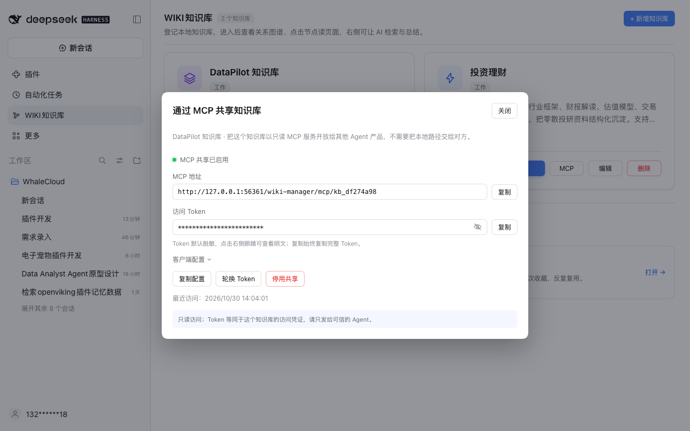
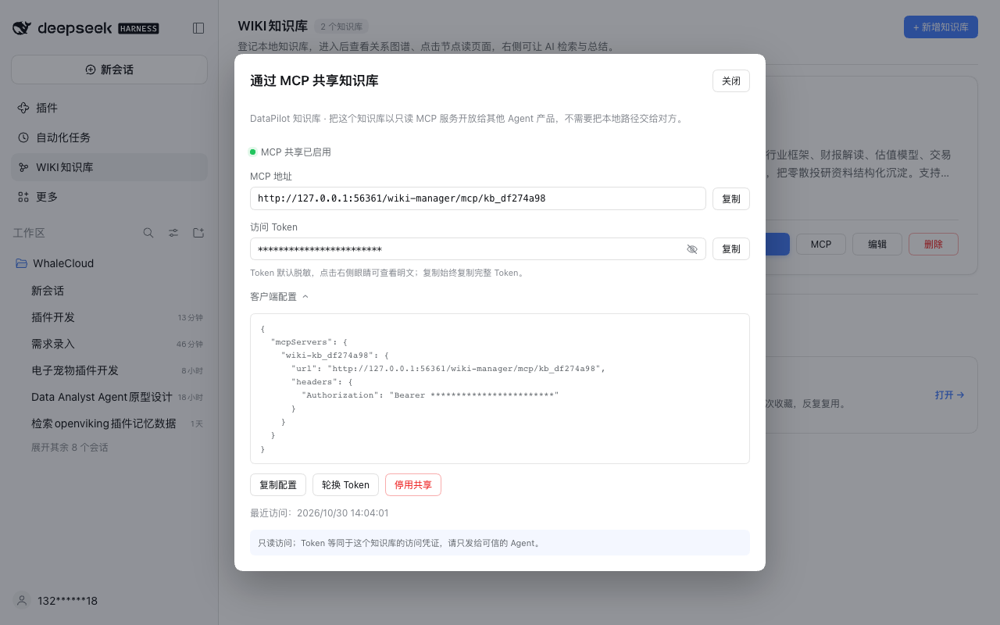
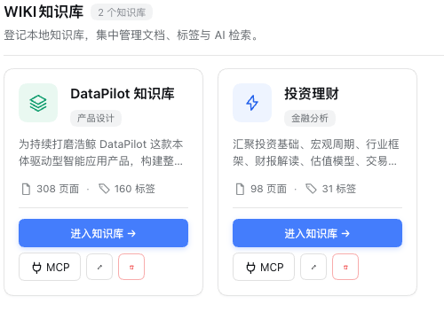
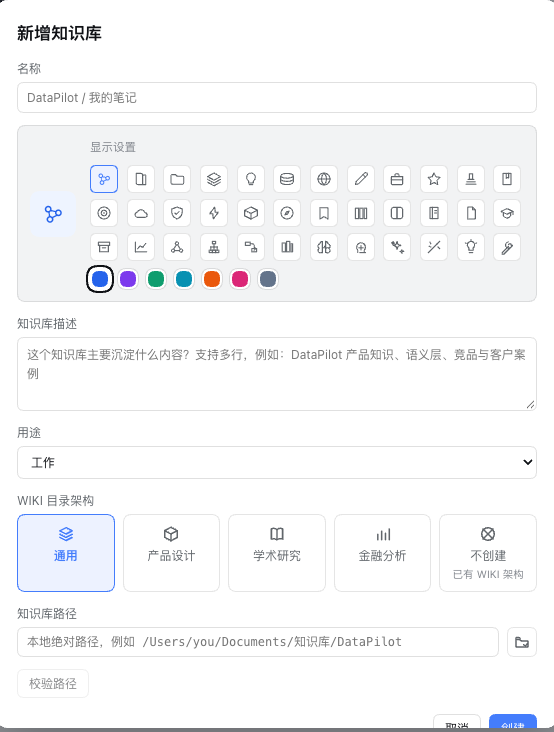
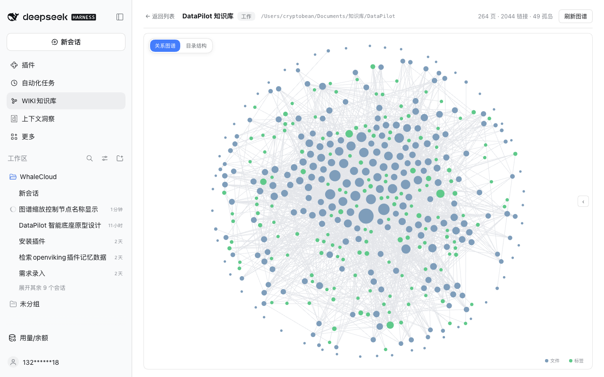

# WIKI Manager · 开发与配置参考

[返回中文首页](../README.md) · [English overview](../README.en.md)

本文保留数据接口、配置、模板、实现细节和已知限制。产品介绍与快速上手请先阅读首页。

## 数据与接口

### 登记表

默认存放在 `$DSH_HOME/wiki-manager/knowledge-bases.json`（可用插件配置 `dataFile` 覆盖）：

```json
{
  "version": 1,
  "activeId": "kb_df274a98",
  "items": [
    { "id": "kb_df274a98", "name": "DataPilot 知识库", "purpose": "工作",
      "path": "/Users/you/Documents/knowledge-base",
      "createdAt": "…", "updatedAt": "…" }
  ]
}
```

### 路由（`/wiki-manager/api`）

| 方法 | 路径 | 作用 |
|---|---|---|
| GET | `/kbs` | 列出知识库 + 每个库的页面数/标签数校验 |
| POST | `/kbs` | 新增（校验绝对路径、去重） |
| PATCH | `/kbs/:id` | 修改 |
| DELETE | `/kbs/:id` | 删除登记 |
| POST | `/active` | 切换当前知识库 |
| POST | `/validate` | 校验路径并返回 `{ pageCount, tagCount, hasTemplates, isVault }` |
| GET | `/graph?kb=` | 图谱 `{ nodes, edges, stats }` |
| POST | `/fs/pick-directory` | 调用宿主原生系统目录选择器，返回 `{ kind:'native', path, canceled }`；无原生能力时返回 `{ kind }`，客户端回退应用内浏览器 |
| GET | `/fs/list?path=` | 目录选择器的单层目录列表：不传 `path` 从主目录开始，返回 `{ path, parent, home, entries, crumbs, truncated }` |
| GET | `/kbs/:id/mcp` | 读取该知识库的 MCP 共享状态与 Token |
| POST | `/kbs/:id/mcp` | 启用 MCP 共享；返回 `{ enabled, endpoint, token, tokenPreview, createdAt, lastUsedAt }` |
| POST | `/kbs/:id/mcp/rotate` | 轮换 MCP Token，旧 Token 立即失效 |
| DELETE | `/kbs/:id/mcp` | 停用 MCP 共享并删除 Token |
| GET | `/tree?kb=&rel=` | 安装目录文件树（单层懒加载）：根层无 `rel`，展开子目录时传 `rel=wiki/...`，返回 `{ path, children, truncated }` |
| GET | `/node?kb=&rel=` | 页面原文 + frontmatter（路径限制在库内） |
| GET | `/catalog?kb=` | 页面目录 + 模板路径（历史提示词工作台使用，接口保留） |
| POST | `/ask`（legacy） | AI 检索（非流式）`{ kb, query }` → `{ answer, sources, model, retrieval }` |
| POST | `/ask-stream` | WIKI AI（SSE 流）：默认驱动该知识库常驻的真实 Agent 会话，推送 `stage` / `thinking` / `step` / `step-result` / `delta` / `sources` / `done`；`agentRuntime: false` 或 Agent 不可用时回退本地检索管线 |
| POST | `/agent-reset` | 清空 / 重置该知识库的 Agent 会话（切换模型或需要重新开始对话时使用） |
| POST | `/lint-task` | 健康体检任务 `{ kb }` → `{ instruction, pages, total, rules }`（纯任务指令，不调模型）；页面集合与关系图谱一致：**全库 .md**（含 `wiki/` 之外的 raw 素材与根目录文档） |

> 桌面端的渲染进程会把同源请求转发给 Host（带认证 Cookie），所以客户端只用 `fetch`，无需类型化 RPC 代码生成。

### MCP 共享

知识库卡片上的 **MCP** 打开「通过 MCP 共享知识库」：

1. 点「启用 MCP 共享」，生成独立 HTTP 地址（`http://127.0.0.1:<port>/wiki-manager/mcp/<kbId>`）和 Bearer Token；
2. Token 输入框默认全量 `*` 脱敏，点右侧眼睛可临时查看明文；「复制」始终复制完整 Token；
3. 「客户端配置」默认折叠，点标题展开；展开的 JSON 中 Token 也是 `*` 脱敏（「复制配置」复制的仍是可直接使用的完整配置）；
4. 复制客户端配置，粘贴到支持 MCP 的 Agent 产品（Claude Desktop、Cursor 等）；
5. 其他 Agent 通过 `tools/list` 看到 5 个只读工具：`kb_info`、`kb_search`、`kb_read`、`kb_list`、`kb_related`，也能通过 `resources/list` / `resources/read` 按 `wiki://<kbId>/<path>` 读取页面；
6. 随时可「轮换 Token」或「停用共享」；停用后 Token 立即失效。

MCP 服务只读，不支持写入。默认地址由 Host 根据当前 HTTP 请求自动推导，桌面端也会返回 `http://127.0.0.1:<port>`，不会使用渲染层的 `dsh-app://`；如果要从其他机器访问，在插件配置里设置 `publicBaseUrl`（例如 `http://192.168.1.10:64432`），并确保该地址可达。若界面仍显示 `dsh-app://`，说明 Host 还是旧代码，需要完全重启 DSH。Token 等同于知识库访问凭证，只发给可信 Agent。



展开客户端配置后，JSON 中的 Token 仍以 `*` 脱敏：



### AI 模型

`/ask` 的执行顺序：

1. **先读 `CLAUDE.md` 的「查询（Query）」章节**（不存在则跳过），提取工作流规则；结果缓存 20s
2. 扫描知识库并定位 `wiki/index.md` 作为**导航索引**
3. 关键词召回页面（标题/标签/正文加权，最多 `maxContextPages` 页）
4. 拼装 Prompt：
   - System：只依据资料、不得编造、答案结构、`[[相对路径]]` 引用、资料不足要明说
   - System 追加：CLAUDE.md 查询规则 + 执行要求（先看导航索引、引用指向 wiki、**如有可复用结论主动询问是否归档回 wiki**）
   - User：问题 + 导航索引（2400 字）+ 召回页面节选（每页 1600 字）
5. 调模型生成回答；响应带 `retrieval: { matched, queryRules, indexIncluded }`

模型路由取：

1. 插件配置的 `provider` + `model`；
2. 否则读 profile 的默认模型（`ctx.agentDefaultModel.currentSelection()`）。

桌面 profile 默认走 `deepseek-account`，无需额外 API Key；web profile 若默认走 `deepseek-official` 则需要配置 `DEEPSEEK_API_KEY`。

### WIKI 架构提示词模板

知识库列表按设计稿重排：卡片固定**一行四个**的宽度（grid 4 列，窄屏两列），不随知识库数量拉伸；左上 44px 圆角图标块（底色跟随图标/用途色调，创建/编辑时可从 36 个内置图标、7 种底色中选择，图标选择区 3 排铺满），右侧 15.5px 标题 + 用途灰底 chip；下方**两行描述（超出省略）**；统计行为「📄 308 页面 · 🏷 160 标签」（行内 SVG 图标）；分隔线后操作区为「进入 →」主按钮（悬停/无障碍标签仍为「进入知识库」）+「MCP」（插头图标）+ 铅笔图标按钮（编辑）+ 红色垃圾桶图标按钮（删除，二次确认）；主按钮文案缩短后，225px 窄卡片下四个操作仍保持单行；不展示知识库路径，未悬停时无蓝色描边；悬停轻微上移 2px 并加深投影。






创建知识库时按「WIKI 目录架构」选项展示的提示词来自独立模板文件，可直接手工编辑：

```
plugins/dsh-llm-wiki/templates/wiki-arch-prompt.md           # 通用（默认）
plugins/dsh-llm-wiki/templates/wiki-arch-prompt-product.md   # 产品设计
plugins/dsh-llm-wiki/templates/wiki-arch-prompt-academic.md  # 学术研究
plugins/dsh-llm-wiki/templates/wiki-arch-prompt-finance.md   # 金融分析
```

- 产品设计 / 学术研究 / 金融分析 的模板各自定制了 wiki/ 子目录结构与领域侧重（例如产品设计侧重功能/流程/信息架构/设计决策/指标体系，学术研究侧重文献/方法/数据集/证据链，金融分析侧重市场/公司/标的/财报/估值模型/论点与反证）

- Host 每次打开弹窗时按 `?template=general|product|academic|finance` 实时读取对应模板文件（未知模板返回 400），**保存后重新打开弹窗即可生效**，无需改代码；不创建（已有 WIKI 架构）不会请求提示词
- 保留以下占位符会被自动替换：`{{知识库根目录}}`、`{{知识领域}}` 或 `{{知识库描述}}`、`{{主要用途}}`、`{{使用工具}}`、`{{内容语言}}`
- 删除或移动该文件会导致弹窗提示模板读取失败

---

## 安装 / 卸载

```bash
cd "$DSH_PROFILE_DIR"                     # 默认 ~/.dsh/profiles/desktop
pnpm add "file:/绝对路径/plugins/dsh-llm-wiki"
# 然后把 "@local/dsh-llm-wiki" 加入 package.json 的 dsh.profile.bundles
# （旧版内置提示词增强器已移除；提示词仓库仍可用）
```

卸载：`pnpm remove @local/dsh-llm-wiki`，并从 `dsh.profile.bundles` 移除包名（登记表数据保留在 `$DSH_HOME/wiki-manager/`）。

---

## 文件结构

```
dsh-llm-wiki/
├── package.json             # bundle + dsh.client（platform: web, immediately）
├── cordis.patch.yml         # 插入 1 个 Host 行（dataFile / 模型 / maxContextPages 配置）
├── index.js                 # Host：登记表、扫描、图谱、页面、目录、AI 检索、MCP 共享
├── client.js                # Client：WIKI 面板 + 内置提示词仓库（单 bundle 合并）
├── prompt-studio/           # 旧版内置提示词增强器资产（已停用，保留备查）
├── icon.svg / locale/*.json # 插件页展示元数据
├── docs/                    # 截图
├── templates/               # 「WIKI 架构提示词」模板：wiki-arch-prompt{,-product,-academic,-finance}.md（可手工编辑）
└── test/                    # host.smoke.mjs（27 项）+ client.smoke.mjs（22 项）
```

---

## 配置

```yaml
- id: wiki-manager
  name: '@local/dsh-llm-wiki'
  config:
    dataFile: /Users/you/.dsh/wiki-manager/knowledge-bases.json  # 登记表位置
    provider: deepseek-account   # 可选，AI 检索用的模型路由
    model: deepseek-flash
    maxContextPages: 6           # 召回页面数上限
    maxAnswerTokens: 900         # 回答长度上限
    useQueryRules: true          # 是否读取 CLAUDE.md「查询（Query）」章节
    maxLintPages: 200            # 体检时送入模型的页面数上限（体检页面范围 = 全库，与关系图谱一致）
    publicBaseUrl: ''            # 可选：MCP 对外地址前缀（跨机访问时设置，如 http://192.168.1.10:64432）
```

生效：`index.js` / `cordis.patch.yml` 改动需重启；`client.js` 改动刷新页面即可。

---

## 实现要点

- **图谱在 Canvas 上自绘**：零依赖力导向（短弹簧 + 硬碰撞 + 弱中心引力）**保证任意缩放下节点圆不重叠**。节点尺寸按连接度（degree）缩放：页面 hub 最大约 16px，普通页面约 3px；标签节点同样按 degree 缩放但整体更小。**页面节点统一一种颜色、标签节点统一绿色**；默认完全不透明；悬停/选中节点后，无连线节点与无关连线**平滑淡化**（约 200ms 缓动，而非瞬间切换），相连边淡入为强调色；只有选中节点带描边，悬停不再描边。未高亮的连线是一条浅灰网格，总览时很淡、放大后会自动加深，保证连线清晰可读。**节点名称按缩放分级显示**：自动适配的总览视图不显示任何名称，只有悬停/选中的节点显示名称；放大超过总览 1.4 倍后显示全部页面与标签名称，名称仍按连接度优先绘制、屏幕空间去重叠、带背景描边保证可读；图谱节点上限 900（按连接度），标签只保留出现 ≥2 次的（最多 160 个）。布局收敛过程中会多次 auto-fit；收敛后会把整张图收敛进画布，并在末尾按最终包围盒重新适配一次，使总览尽量撑满画布（留 26px 边距），并把外圈（标签/孤立页面所在的外环）向中心再压紧 30%；随后按实际倍率在屏幕空间做一次圆点去重叠。**页面与标签交错分布**：初始位置按全局连接度排序，文件和标签的圆点在整个圆内交错铺开，不再让标签独占外圈边缘。**圆点大小与间距随缩放同比调整**（放大最多到 2.2×，缩小同比缩小），因此任意缩放、拖拽、回弹状态都不会出现节点叠压。图例固定只有「文件」「标签」两项，分别整体显示/隐藏页面节点与标签节点。拖动节点会临时钉住，松手后以阻尼弹簧回到原位，邻居沿边产生短暂回弹。滚轮/拖拽随时接管视图。
- **WIKI AI 默认驱动原生 Agent**：每次提问交给该知识库常驻的真实 Agent 会话，创建方式与 GUI/ACP 会话一致——先经 `agentPresets` 服务挂载默认 agent preset（`meta.agentPreset` + `setup` 中 `presets.mount`），因此具备标准工具面与会话链路，而不是裸 factory agent（裸 agent 首轮模型请求会直接失败并回退）；Agent 的思考过程、工具步骤、流式回答与引用页面实时渲染，可「停止」、「在会话中打开」；首轮消息以完整 user Message（`role`/`id`/`content`/`source`）写入会话，避免会话校验失败与 transport 重试；Agent 不可用或 `agentRuntime: false` 时回退本地检索管线。失败时回退提示会带上完整错误因果链（含底层 cause），便于定位真因。底部输入框兼作页面检索（输入标题/路径即在输入框上方筛选并可直接打开页面）。
- **体检口径与关系图谱一致**：健康体检（检查知识库 / 断链扫描 / 孤立页面 / 周报）统一按**全库 .md 页面**统计（例如 DataPilot 为 264 页 = wiki 186 · raw 75 · 根目录 3），与顶栏「N 页」和图谱节点数同源；报告里会给出**页面构成**拆分，孤立页面同样给出构成（如 49 = raw 47 · 根目录 2），不会再出现「顶栏 264、体检 186」这类口径不一致。
- **安全边界**：页面读取只允许登记库根目录内的文件（`resolve` 后前缀校验），阻断 `../` 越权；登记路径必须是存在的绝对目录。
- **客户端零 RPC 依赖**：数据来自 Host 命名 HTTP 路由；Host 的 `llm`/`agentDefaultModel` 是**按需查找**（`ctx.get(...)`），缺失时 AI 页签报错但插件照常激活。
- **`@` 词条注册可安全热更新**：客户端热更新会重新执行插件 `apply`，而输入触发器服务对 `(trigger, name)` 判重、重复注册会直接抛错；现在注册前先回收上一次注册返回的 disposer（记在 `globalThis.__wikiTriggerDispose`），所以热更新后「知识库」分组不会从输入框菜单里消失（旧版本会消失，需要整页刷新才恢复）。
- **输入框 `+` 与 `@` 的分工（DSH 2026-11 升级后）**：新版本把输入框左侧「+」改成只列 `/` 斜杠指令的菜单；文件、知识库、对话这类「@ 提及」统一从 `@` 呼出（`+` 菜单不再列提及源，插件侧无法向其中注入分组）。所以知识库引用请用 `@`：输入 `@` 后第一组即「知识库」，选中插入引用 chip。另注意：输入框里残留 `@`/`/` 草稿时提及菜单可能不弹出，清空输入框或刷新页面后重输 `@` 即可。

- **Markdown 渲染是转义后自建的安全子集**：不支持原始 HTML，避免知识库内容注入。

---

## 与 Obsidian 图谱的差异

Obsidian 本身是**闭源商业软件**，没有可直接复用的图谱源码；社区可参考的实现有 `fast-graph-view`（WebGL + Worker Barnes–Hut）、`speed-graph`（Rust/WASM 布局 + WebGL2）、`sigma.js`/`graphology`、`force-graph`。WIKI 插件为了保持单文件、零依赖，继续使用 Canvas 自绘，只借鉴行为和视觉：

- **全量节点范围**：Obsidian 默认把整个 vault 的 Markdown、附件、全部标签都画进图；WIKI 现在也扫描**全 vault Markdown**（`wiki/`、`raw/`、`deliverables/` 等），标签阈值降到出现 ≥2 次，节点上限 900。
- **连接度即大小**：页面节点按 degree 平方根缩放，hub 最大约 16px，普通页面约 3px；标签节点同样按 degree 缩放。
- **连续物理**：全局多体斥力 + 弱弹簧连接 + 硬碰撞；auto-fit 收敛后会把布局整体收敛进画布（缩放触底 0.2× 时整张图完整可见、不再裁切），并把外圈节点向中心再压紧 30%；随后按实际倍率做一次屏幕空间去重叠，圆点大小随缩放同比调整，保证任何缩放/拖动/回弹都不叠点。拖动节点会钉住，松手后以阻尼弹簧回位，邻居沿边短暂回弹，而不是一次性算完就冻结。
- **低倍率不显示节点名称**：总览（auto-fit）视图完全不显示名称，只有悬停/选中的节点会显示名称；放大超过总览倍率 1.4 倍后恢复全部页面/标签名称，仍按连接度优先绘制并去重叠，避免几百个标签叠成一团。
- **仍有的差距**：没有把 PDF/图片附件作为节点；Canvas 仍是 CPU 力导向布局，500+ 节点时需要几秒动画收敛（收敛期间圆点从约 45% 的尺寸平滑长到正常大小，不会出现一堆看不清的小点或糊成一团）；没有 Obsidian 的搜索、颜色分组、局部图（local graph）和过滤器面板。



## 已知限制

- 图谱力导向在 500+ 节点时可读性一般（要更精确的聚类/分簇需要额外布局算法）；当前已按连接度裁剪并自动适配视口。
- 标签节点只保留出现 ≥2 次的高频标签（最多 160 个），低频标签不显示。
- 图谱范围是**全 vault 的 Markdown**（`wiki/`、`raw/`、`deliverables/` 等）**+ 高频标签**，不含 PDF/图片等附件；Obsidian 默认图还会把附件和全部标签都算作节点，因此节点数仍会更多。全量附件视图会显著增加布局成本，暂不做默认。
- AI 检索是**关键词召回**而非向量检索；召回不到时会在回答里明确说"未找到直接依据"。
- 页面正文按原 Markdown 渲染，不解析 Obsidian 插件语法（Dataview/Bases 等）。
